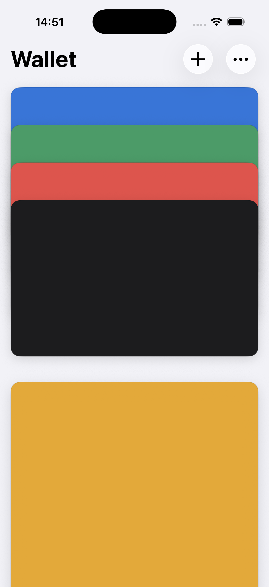
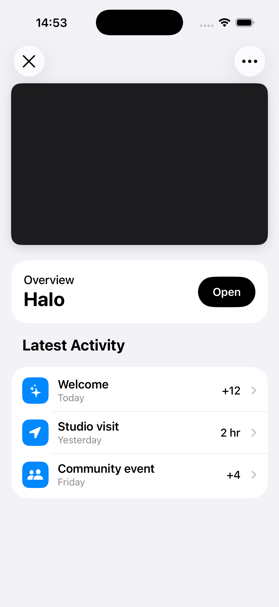
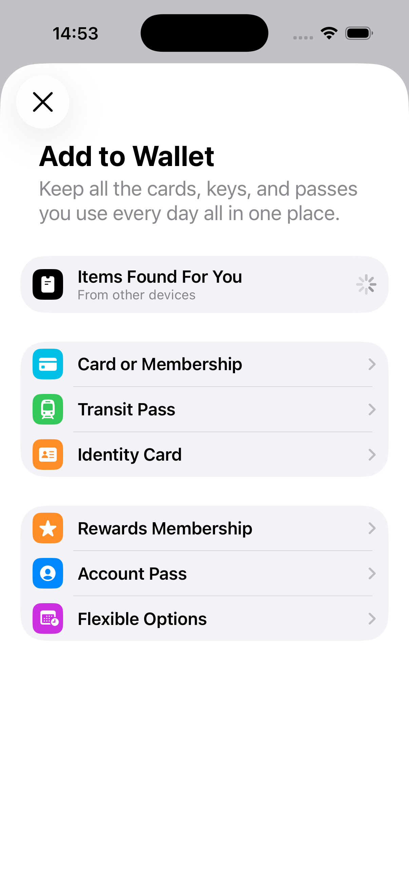

# wallet-shell

A small SwiftUI project that recreates the look, feel, and card motion of Apple Wallet.

It has four sample cards, one pass, card selection, interactive dismissal, stack reordering, pull-down stretching, and a few visual-only menus. There is no payment logic, PassKit integration, networking, or real card data.

  
  
  

## Running it

Open `WalletPrototype.xcodeproj` in Xcode 26 or newer and run the `WalletPrototype` scheme on an iPhone simulator running iOS 26.

The layout is tuned around iPhone 14 and iPhone 17 Pro screen sizes. The app is portrait-only and uses the light appearance.

## Notes

This is a visual shell and motion study built as a personal project. All cards and passes use neutral sample data and simple colors.
